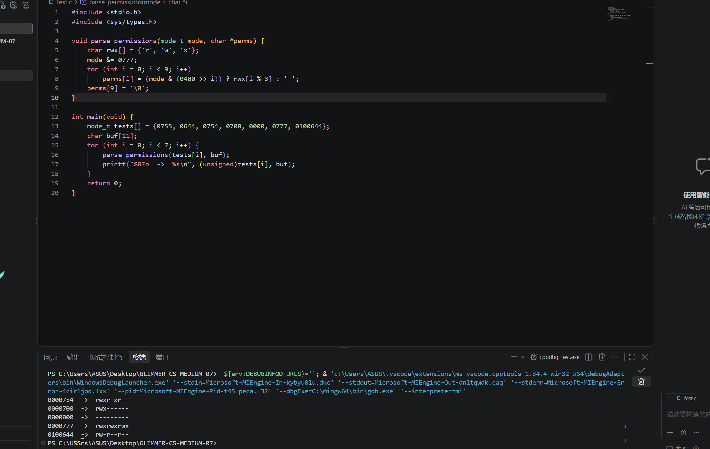

# 一
1.1
定义：
绝对路径：从根目录 / 开始写，写全，和「你现在在哪」完全无关。
相对路径：不从 / 开始，从「当前工作目录」算起，同一串字符在不同目录下指向不同东西。

第一个字符是 /	->绝对路径
第一个字符是 .、..、~、-，或直接是名字->	相对路径（~ 由 shell 展开成家目录后仍是绝对路径，但书写形式是相对习惯）
出现在 PATH 里的命令名（如 ls）	->既不是路径也不是相对路径，是「命令查找」
./script.sh	->相对路径；. 是为了绕过 PATH 查找

绝对路径
cd /var/backups/turing

相对路径（当前位于 /home/lin/workspace/，向上三级到 / 再进 var）
cd ../../../var/backups/turing

1.2
argc（argument count）：命令行参数的个数，类型 int。它是「参数个数 + 1」。
argv（argument vector）：一个字符串指针数组，char *argv[] 等价于 char **argv。每个元素指向一个以 \0 结尾的 C 字符串。

绝对路径的命令中，argc是2，argv[0]是cd;
相对路径的命令中，argc是2，argv[0]是cd

argv[0]指向	"cd"
argv[1]指向 "/var/backups/turing"
argv[2]指向NULL
# 二
2.1
1. 
#include <stdio.h>
#include <stdlib.h>
#include<string.h>
#include <time.h>是见过的
剩下的基本都没见过或者很少见

<dirent.h>：目录项（directory entry）。它负责回答「这个目录里有哪些名字」，不提供文件内容，也不提供权限、大小。
<sys/stat.h>：文件元数据（metadata）。它负责回答「这个文件是什么类型、多大、属主是谁、几个硬链接、何时修改」。它不管目录里有哪些名字。

2. <dirent.h> 与 <sys/stat.h> 的关键结构体和函数

一、<dirent.h>：目录遍历

关键结构体：
- struct dirent：表示一个目录项，常用成员有
    d_name  文件名（只有名字，不含路径）
    d_type  文件类型提示（DT_REG、DT_DIR、DT_LNK 等）
    d_ino   inode 号
- DIR：不透明的"目录流"类型，类似 FILE*，由 opendir 返回。

关键函数：
- opendir(path)      打开目录，失败返回 NULL
- readdir(dirp)      读取下一个目录项，读完或出错返回 NULL
- closedir(dirp)     关闭目录流
- scandir(...)       一次性读取整个目录到数组，可过滤、排序

作用：获取"某个目录里有哪些文件"，即文件名字列表；
不提供文件大小、权限等属性。

二、<sys/stat.h>：文件元数据

关键结构体：
- struct stat：保存文件的元数据，常用成员有
    st_mode   文件类型 + 权限位（用 S_ISDIR 等宏解析）
    st_size   文件大小（字节）
    st_mtim   最后修改时间（struct timespec）
    st_uid / st_gid   属主 / 属组
    st_nlink  硬链接数
    st_ino    inode 号
    st_blocks 占用磁盘块数

关键函数：
- stat(path, &buf)    按路径获取元数据，会跟随符号链接
- lstat(path, &buf)   同上，但不跟随符号链接（取链接本身的信息）
- fstat(fd, &buf)     按已打开的文件描述符获取
- chmod(path, mode)   修改权限
- mkdir(path, mode)   创建目录
- umask(mask)         设置/读取权限掩码

关键宏：
- S_ISDIR / S_ISREG / S_ISLNK / S_ISCHR / S_ISBLK / S_ISFIFO / S_ISSOCK
  判断文件类型
- S_IRUSR、S_IWUSR、S_IXUSR、S_IRGRP、S_IROTH ... 权限位常量
- S_ISUID、S_ISGID、S_ISVTX  特殊权限位

作用：获取文件的类型、大小、权限、属主、时间戳等属性；
不提供目录中的文件名列表。

三、两者的关系
dirent.h 负责"目录里有哪些名字"，sys/stat.h 负责"这个名字对应的文件有什么属性"。
典型用法：opendir + readdir 取到 d_name，拼成"path/d_name"路径后调用 stat/lstat，
即可同时得到文件名和它的详细信息（ls -l 的实现原理）。
2.2
文件的权限是一个整数，本质是 9 个二进制开关：
高位到低位依次是属主的 rwx、属组的 rwx、其他人的 rwx，
用八进制 3 位一组书写即为 0755 这种形式；
st_mode 的高位还混有文件类型，取值时需用 0777 掩码屏蔽；
权限的查询与修改都通过按位与(&)、按位或(|)、按位取反(~)完成，
rwxr-xr-x 这类字符串只是这个整数的一种可视化形式。

void parse_permissions(mode_t mode, char *perms) {

    // 权限字符对照表
    char rwx[] = {'r', 'w', 'x'};

    mode &= 0777;                       // 屏蔽文件类型等高位，只留 9 位权限
    for (int i = 0; i < 9; i++)         // 从 0400 逐位右移到 0001
        perms[i] = (mode & (0400 >> i)) ? rwx[i % 3] : '-';

    perms[9] = '\0'; // 字符串结尾
}

# 三
3.1
1. Inode 中存储的信息
inode（索引节点）是文件系统中描述文件的元数据结构，主要包含：
- 文件类型：普通文件、目录、符号链接、字符设备、块设备、FIFO、socket
- 权限与模式：rwx 权限位，以及 setuid / setgid / sticky 标志
- 属主与属组：UID 和 GID
- 文件大小：字节数（st_size）
- 时间戳：atime（访问）、mtime（内容修改）、ctime（inode 状态变化）
- 硬链接计数（st_nlink）
- 数据块的位置指针：直接块、间接块或 extent，指向磁盘上真正存数据的位置
- inode 号本身，以及块大小、占用块数、扩展属性等

2. Inode 中不包含的信息
- 文件名：文件名保存在目录文件中，不在 inode 里。正因为如此，一个 inode
  才可能对应多个文件名（硬链接），重命名也只需修改目录项。
- 文件的实际内容：内容存放在数据块中，inode 只记录数据块地址。
- 完整路径：路径由目录逐层解析得到，inode 中没有路径字段。
- 父目录信息：inode 没有父目录指针，父子关系由目录内容中的 ".." 体现。

3. "." 与 ".."
- "." 表示当前目录自身，其 inode 号就是该目录的 inode 号。
- ".." 表示父目录，其 inode 号是上一级目录的 inode 号。

在根目录 "/" 下：
- "/." 和 "/.." 指向同一个 inode，即根目录自身的 inode（ext 系列中通常为 2）。
- 因为根目录没有父目录，让 ".." 指向自己，可以使 "cd .." 在根目录原地不动，
  从而为目录树提供上溯的终止边界，避免越界和死循环。

#define _GNU_SOURCE
#include <stdio.h>
#include <stdlib.h>
#include <string.h>
#include <unistd.h>
#include <fcntl.h>
#include <sys/stat.h>
#include <sys/types.h>
#include <dirent.h>

/* 题目已给出的函数 */
ino_t get_inode(const char *path) {
    struct stat statbuf;
    if (stat(path, &statbuf) == -1) {
        perror("stat failed");
        exit(EXIT_FAILURE);
    }
    return statbuf.st_ino;
}

/* 工具：在目录 dir 中找出 inode 号为 target 的条目名（跳过 . 和 ..） */
static int name_of_inode(const char *dir, ino_t target, char *name, size_t n) {
    DIR *d = opendir(dir);
    if (d == NULL) return -1;

    struct dirent *e;
    int ret = -1;
    while ((e = readdir(d)) != NULL) {
        if (strcmp(e->d_name, ".") == 0 || strcmp(e->d_name, "..") == 0)
            continue;
        if (e->d_ino == target) {          /* 身份证对上了 */
            snprintf(name, n, "%s", e->d_name);
            ret = 0;
            break;
        }
    }
    closedir(d);
    return ret;
}

/* 自己实现 getcwd */
char *my_getcwd(char *buf, size_t size) {
    int fd = open(".", O_RDONLY | O_DIRECTORY);   /* 留一扇回家的门 */
    if (fd < 0) return NULL;

    char path[4096];
    path[0] = '\0';                              /* 从空字符串开始，往前拼 */

    for (;;) {
        if (get_inode(".") == get_inode(".."))   /* 到根了，刹车 */
            break;

        ino_t child = get_inode(".");            /* 记住"我"的身份证 */
        if (chdir("..") != 0) { close(fd); return NULL; }   /* 上一层 */

        char name[256];
        if (name_of_inode(".", child, name, sizeof(name)) != 0) {
            close(fd);                           /* 可能被删除/改名了 */
            return NULL;
        }

        char tmp[4096];
        if (snprintf(tmp, sizeof(tmp), "/%s%s", name, path) >= (int)sizeof(tmp)) {
            close(fd);                           /* 超长 */
            return NULL;
        }
        strcpy(path, tmp);                       /* path = "/" + name + path */
    }

    fchdir(fd);                                  /* 回到原来的目录 */
    close(fd);

    if (path[0] == '\0') strcpy(path, "/");      /* 本来就在根 */

    if (strlen(path) + 1 > size) return NULL;
    strcpy(buf, path);
    return buf;
}

/* 测试 */
int main(void) {
    char buf[4096];
    if (my_getcwd(buf, sizeof(buf)) == NULL) {
        perror("my_getcwd");
        return 1;
    }
    printf("%s\n", buf);
    return 0;
}

思路：
1. 先用 open(".") 保存当前目录的 fd，最后用 fchdir() 恢复。
2. 用 stat(".") 取当前目录 inode，与 stat("..") 比较；相等说明已在根目录。
3. 否则记下当前 inode，chdir("..") 进入父目录。
4. 在父目录中 opendir/readdir 遍历，找到 d_ino 等于刚才记下的 inode 的条目，
   该条目的 d_name 就是当前目录名。
5. 把 "/" + 名字 拼到已有路径的左边（因为是自底向上回溯）。
6. 重复 2~5 直到 "." 与 ".." 的 inode 相同，得到完整绝对路径

4.1
// 1. 名字匹配就打印
        if (strcmp(entry->d_name, target_name) == 0) {
            printf("%s\n", full_path);
        }

// 2. 是目录就递归深入（深度优先）
        if ((statbuf.st_mode & S_IFMT) == S_IFDIR) {
            find_file(full_path, target_name);
        }

